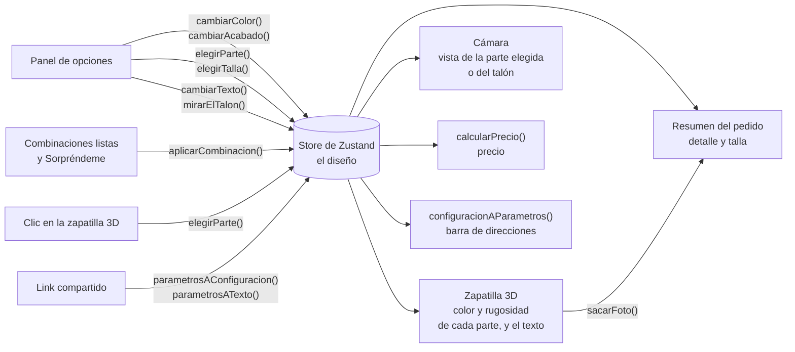

# Pisada · Configurador 3D de zapatillas

[](https://github.com/Vitomans/configurador-3d/actions/workflows/ci.yml)

Un configurador de producto para una tienda de zapatillas ficticia. Gira la zapatilla en 3D, cambia el color y el acabado de cada parte, ponle tus iniciales en el talón, mira cómo cambia el precio, comparte tu diseño exacto con un link y ciérralo con una compra simulada, con una foto de tu diseño.

**Demo en vivo: [pisada-3d.vercel.app](https://pisada-3d.vercel.app)**


*El cuerpo se pone rojo. Al tocar la suela en la zapatilla 3D, el panel pasa a "Suela". El color caramelo (+US$ 10) y el acabado brillante (+US$ 8) suben el precio, y la barra de direcciones guarda el diseño. Después, una vuelta completa, y "Copiar link" copia el link.*

## Funcionalidades


- **Visor 3D:** arrastra para girar y usa la rueda para acercar, o desliza y pellizca en el celular. Luces tipo estudio de fotos, un fondo de estudio y una sombra suave.
- **Entrada animada:** al cargar, la cámara se acerca con un movimiento suave y la zapatilla gira sola hasta que la tocas. Si el sistema pide reducir el movimiento, se queda quieta.
- **Cinco partes para personalizar:** cuerpo, franjas, suela, cordones y detalles. Cada una tiene 5 o 6 colores y un acabado mate o brillante.
- **Combinaciones listas:** Clásica, Nocturna, Retro y Sendero cambian toda la zapatilla con un clic, "Sorpréndeme" arma una al azar y "Original" vuelve al diseño inicial. En el celular van en una fila que se desliza de lado.
- **Elegir una parte en la zapatilla:** al hacer clic (o tocar) una parte del modelo 3D, el panel pasa a esa parte.
- **La cámara va a la parte:** al elegir una parte, en el panel o en la zapatilla, la cámara gira suave hasta mostrarla y la parte da un destello. Con el mouse, la parte que está debajo se resalta, y los cambios de color y de acabado son suaves.
- **Texto en el talón:** hasta 3 letras o números (tus iniciales o tu número) aparecen pegados en el talón de la zapatilla 3D, con la letra de la marca. Al tocar el campo, la cámara va al talón para que veas el texto mientras escribes. Sale en blanco o en negro, el que más se distinga del color del cuerpo.
- **Precio en vivo:** un precio base de US$ 120, más US$ 8 por cada parte brillante, US$ 10 por la suela caramelo y US$ 5 por el texto del talón.
- **Link para compartir:** el diseño se guarda en el link (`?cuerpo=rojo&suela=caramelo&texto=VM`) y al abrirlo se carga el mismo diseño. "Compartir", sobre la zapatilla, abre el menú de compartir del teléfono en el celular y copia el link en el computador. Al compartirlo en WhatsApp o LinkedIn se ve una imagen de la tienda.
- **Compra simulada:** eliges tu talla y "Agregar al carrito" abre el resumen del pedido, con una foto de tu diseño sacada del 3D (desde atrás si lleva texto, para que se vea), el color y el acabado de cada parte, el texto, lo que suma cada cosa y el total. Desde ahí puedes descargar la foto o compartir el diseño. Sin talla no se agrega: la página te lleva a las tallas y te avisa. No se cobra nada.
- **Pensado para el celular:** la zapatilla queda fija arriba mientras las opciones se desplazan abajo, y el precio y "Agregar al carrito" siempre se ven. Arrastrar sobre la zapatilla la gira en vez de mover la página.
- **Accesible:** todas las opciones funcionan con el teclado y con lectores de pantalla, y el círculo de carga respeta la opción "reducir movimiento".

<br clear="right">

## Tecnologías

- [Next.js](https://nextjs.org) 16 (App Router), React 19 y TypeScript
- Tailwind CSS 4
- Three.js con [React Three Fiber](https://r3f.docs.pmnd.rs) y drei
- Zustand para el estado compartido
- `next/og` para dibujar la imagen para compartir el link
- APIs del navegador: `<dialog>` para el resumen del pedido, Web Share y el portapapeles para compartir, y canvas para la foto y para dibujar el texto del talón
- glTF Transform, meshoptimizer y sharp, para preparar el modelo 3D
- Vitest para los tests unitarios y Playwright para los tests de punta a punta (e2e)
- GitHub Actions: lint, tipos, tests, build y tests e2e en cada push

## Cómo funciona



1. El panel y la zapatilla 3D comparten un store de Zustand con el diseño (el color y el acabado de cada parte, y el texto del talón), con la parte elegida y con lo que muestra la cámara.
2. Cuando cambia el diseño, la zapatilla 3D pasa suave a sus colores nuevos, el precio se vuelve a calcular y la barra de direcciones recibe el link nuevo. Cuando cambia la parte elegida, la cámara va a mostrarla, y al tocar el campo del texto, va al talón.
3. Cuando alguien abre un link compartido, el diseño se lee del link y se carga en el store.
4. Al agregar al carrito, el resumen del pedido le pide una foto a la zapatilla 3D y muestra el diseño, la talla y el precio detallado.

## Estructura del proyecto

```
configurador-3d/
├── app/                ← la página (App Router de Next.js), el ícono y la imagen para compartir
├── assets/             ← la letra y la foto de la zapatilla que usa la imagen para compartir
├── components/         ← visor 3D, cámara, la zapatilla 3D, su texto y su foto, logo, panel de opciones, barra de compra, resumen del pedido y botón para compartir
├── hooks/              ← mantiene sincronizados el diseño y el link, y comparte el link
├── lib/                ← catálogo, combinaciones, vistas de la cámara y funciones del precio, del link, del texto y del resalte (con tests)
├── store/              ← estado compartido con Zustand
├── scripts/            ← separa en partes el modelo 3D original
├── public/modelos/     ← el modelo ya preparado (400 KB)
├── tests/              ← tests unitarios (Vitest), y tests e2e en tests/e2e (Playwright)
└── docs/               ← el GIF y la captura de este README
```

## Cómo correrlo en local

Necesitas Node.js 24 (ver `.nvmrc`).

```bash
npm install
npm run dev
```

Después abre [http://localhost:3000](http://localhost:3000).

Para correr los tests e2e, instala una vez el navegador de Playwright:

```bash
npx playwright install chromium
npm run e2e
```

## Decisiones técnicas

**Un script separó el modelo 3D en partes.** El modelo original es una sola malla, y el color de cada parte está pintado en una imagen (una textura). Así no se puede cambiar una parte sola. [`scripts/preparar-modelo.mts`](scripts/preparar-modelo.mts) lee el color de la textura bajo cada triángulo, junta en piezas los triángulos que se tocan (un cordón, una franja, la suela...) y arma una malla por parte, cada una con su propio material. Mantiene el relieve de la tela (normal map), quita las texturas de color y comprime el resto: el archivo baja de 7,8 MB a 400 KB, así que carga rápido en el celular.

**La lógica está separada de React y del 3D.** El catálogo (partes, colores y precios) son solo datos, en `lib/opciones.ts`. El precio y el link son funciones puras en `lib/precio.ts` y `lib/url.ts`: con lo mismo siempre devuelven lo mismo, y no tocan la página. Por eso es fácil hacerles tests unitarios.

**Un solo store para el panel y la zapatilla 3D.** El panel de opciones y la zapatilla 3D están en partes distintas de la página, pero los dos necesitan el diseño. Lo guarda un store de Zustand, así ningún componente tiene que pasarlo hacia abajo por props. Cada componente lee solo lo que necesita: la zapatilla 3D no se vuelve a dibujar cuando solo cambias la parte elegida. Los cambios crean una copia nueva del diseño en vez de modificarlo, así React se da cuenta de que algo cambió.

**El link es el diseño guardado.** No hay backend: el link guarda el diseño, así que para compartirlo no se necesita nada más. Solo guarda lo que cambió respecto al diseño inicial, así el link queda corto. Cualquiera puede escribir un link, así que la página revisa cada valor al leerlo: un color que no existe, como `suela=morado`, se ignora y esa parte queda como al inicio. La barra de direcciones se actualiza con `history.replaceState`, así el botón "atrás" no pasa por cada color que probaste.

**Las combinaciones son diseños completos, y la marcada se calcula.** Cada combinación de [`lib/combinaciones.ts`](lib/combinaciones.ts) tiene la misma forma que el diseño del store, así que aplicarla es reemplazar el diseño: el precio, el link y la zapatilla se actualizan solos, como con cualquier cambio. No se guarda cuál combinación elegiste: una aparece marcada si el diseño es justo ese, comparando parte por parte. Así, si cambias un color a mano, deja de estar marcada sin programar nada más. Al aplicar una, el panel vuelve al cuerpo y la cámara muestra la zapatilla completa, porque cambió toda.

**"Sorpréndeme" recibe el azar como parámetro.** `combinacionAlAzar()` elige un color al azar de los que tiene cada parte, y una de cada cuatro partes sale brillante. Los números al azar vienen de una función que se le pasa (`Math.random` si no se le pasa nada): los tests le pasan números fijos y saben qué va a salir. Las franjas nunca salen del color del cuerpo, porque casi no se verían; en Nocturna es a propósito, y se distinguen por el brillo.

**Cambiar un color no vuelve a armar la zapatilla 3D.** Cada parte mantiene su malla y su material, y solo cambian el `color` y la rugosidad (`roughness`) del material. El acabado es solo la rugosidad: 0,85 reparte la luz (mate) y 0,3 la refleja (brillante). El cambio es suave: en cada cuadro (`useFrame`), el color avanza una parte del camino que le falta al elegido (`lerp`), y en un cuarto de segundo ya hizo el 95 %. Lo que se anima se guarda en `useRef` y no en `useState`: cambia 60 veces por segundo y no hace falta que React vuelva a dibujar el componente.

**Un clic elige una parte y arrastrar gira.** Las dos cosas empiezan con el mismo botón del mouse. Un clic solo elige una parte si el puntero se movió menos de 2 píxeles, y se detiene ahí, así solo cuenta la parte de más adelante y no las que están detrás.

**La cámara entra sola y la zapatilla gira hasta que la tocas.** En vez de `OrbitControls` se usa `CameraControls` de drei, que además de girar y acercar sabe llevar la cámara a un punto con un movimiento suave: `setLookAt(..., true)` hace el viaje y devuelve una promesa que se cumple cuando la cámara llega. Ahí empieza el giro: en cada cuadro (`useFrame`) se le suma un poco al ángulo de la cámara, multiplicado por `delta` (los segundos desde el cuadro anterior), así gira a la misma velocidad en un computador rápido o lento. Si está girando o no se guarda en un `useRef` y no en un `useState`, porque cambiarlo no necesita volver a dibujar nada en React. Apenas la persona toca la zapatilla o usa la rueda (`onStart`), deja de girar. Si el sistema pide reducir el movimiento (`prefers-reduced-motion`), la cámara salta a su lugar y no gira.

**Cada parte tiene su vista, guardada como datos.** [`lib/vistas.ts`](lib/vistas.ts) dice desde dónde mira la cámara a cada parte: de lado para las franjas, a ras del suelo para la suela, desde arriba para los cordones y desde atrás para el talón. Al elegir una parte, en el panel o en la zapatilla, la cámara viaja con el mismo `setLookAt` de la entrada y deja de girar sola, para que la parte quede a la vista. Un test unitario revisa que cada vista respete los límites de la cámara (distancia y ángulo): si una se sale, los controles la corrigen y la cámara no termina donde se pensó.

**El texto del talón es una calcomanía.** El texto se dibuja en un canvas 2D, con la letra de la marca, y ese dibujo se pega en el 3D como una imagen (una textura) con `Decal` de drei. `Decal` funciona como un proyector: lanza la imagen sobre la superficie del cuerpo, así se dobla con la curva del talón. El lugar se midió leyendo los puntos del modelo con un script: entre el parche naranjo y la suela, donde la tela es lisa (el parche trae en relieve el logo del modelo original). Tres detalles:

- Un canvas no espera a que la letra se descargue: si no está lista, dibuja con otra. Por eso primero se pide con `document.fonts.load()` y se dibuja cuando llegó.
- `Decal` trae un material que se dibuja encima de todo, y el texto se vería a través de la zapatilla al mirarla de frente. Lleva un material propio, con luz como el resto de la zapatilla y respetando lo que está delante (`depthTest`). `polygonOffset` lo dibuja apenas por delante del cuerpo, para que los dos no se mezclen.
- El modelo está comprimido: cada pieza guarda sus puntos en su propia escala. `Decal` trabaja con esos puntos, así que el centro y el tamaño del texto se pasan a la escala de la pieza.

**Un solo filtro para el texto, en el panel y en el link.** `limpiarTexto()` ([`lib/texto.ts`](lib/texto.ts)) deja el texto en mayúsculas, solo con letras (con la Ñ) y números, y con 3 caracteres como máximo: "v.m" queda en "VM". La usan el campo del panel y la lectura del link, así un link escrito a mano termina igual que si se hubiera escrito en el campo. A diferencia de la talla, el texto sí va en el link: es parte del diseño que se comparte. Las combinaciones listas cambian los colores pero no el texto, porque es de la persona.

**El color del texto se elige por contraste.** El texto va en blanco o en negro, el que más se distinga del color del cuerpo, medido con la fórmula de contraste de las pautas de accesibilidad (WCAG). Así se lee con cualquier diseño, y un test revisa que con los 6 colores del cuerpo el contraste llegue al 4,5 que piden las pautas. Con la luminosidad simple (la del resalte), el gris habría llevado texto blanco, y se lee mejor en negro.

**La cámara sigue a la "vista", no a la parte.** Al tocar el campo del texto, la cámara va al talón, pero el panel sigue editando la misma parte. Por eso el store guarda aparte lo que muestra la cámara (`vista`: una parte o el talón) y la parte que se edita (`parteActiva`). Elegir una parte cambia las dos, y tocar el campo solo cambia la vista.

**El resalte se nota con cualquier color.** Primero se probó sumarle luz a la pieza, pero el azul marino quedaba casi gris y en una suela blanca no se notaba nada. Un contorno tampoco sirvió: las franjas y el cuerpo son superficies abiertas y el contorno salía a medias o no salía. Lo que quedó: la pieza se aclara si es oscura y se oscurece si es clara, cambiando su luminosidad medida como la ve el ojo (HSL en sRGB, en [`lib/resalte.ts`](lib/resalte.ts)). Con el mouse encima la pieza va a la mitad de ese cambio. Al elegirla da un destello que se apaga en menos de un segundo: un resalte fijo cambiaría el color que estás eligiendo. El resalte del mouse es solo para el mouse (`pointerType`), porque en una pantalla táctil la pieza quedaría resaltada después de tocarla.

**El fondo de estudio es HTML, detrás de un canvas transparente.** El canvas 3D no tiene fondo propio. El degradado claro al centro y el nombre "PISADA" gigante son HTML normal que está detrás, así que no le suman trabajo al 3D. El tamaño del nombre se mide con el ancho del visor (`cqw`, con `@container` de Tailwind), así cabe igual en el celular y en el escritorio.

**La imagen para compartir se dibuja al compilar.** [`app/opengraph-image.tsx`](app/opengraph-image.tsx) arma la imagen con JSX y `ImageResponse` de `next/og`, y Next.js agrega solo las etiquetas `og:image` que leen WhatsApp, LinkedIn y otros. El 3D no se puede dibujar en el servidor, así que la imagen usa una foto de la zapatilla con fondo transparente, sacada de la misma página. La letra de la marca (Archivo) es "variable" en la página: un solo archivo trae todos los anchos y grosores. `next/og` no entiende ese tipo de archivo, así que usa uno fijo con la versión extendida, gruesa y en cursiva.

**La foto del pedido sale del mismo 3D, con una cámara aparte.** El botón "Agregar al carrito" está fuera del canvas 3D, así que un componente de adentro ([`Fotografo.tsx`](components/Fotografo.tsx)) deja en el store la función `sacarFoto()`, y la barra de compra la llama. La foto usa su propia cámara, en la vista de toda la zapatilla, así sale igual aunque estés mirando la suela de cerca. Si lleva texto, la foto se saca desde atrás y un poco de lado, para que se lea el texto. Por un momento el canvas cambia a 1080 × 1080 píxeles (sin cambiar su tamaño en la página), dibuja la zapatilla y la copia sobre el fondo de estudio en un canvas 2D. Después vuelve a su tamaño y dibuja de nuevo la vista normal. Como todo pasa seguido, antes de que la pantalla se actualice, nunca ves la cámara de la foto. La foto se guarda en JPG y no en PNG: tiene fondo, así que no necesita transparencia, y en Chrome el PNG tardaba hasta un segundo en armarse (el degradado del fondo se comprime mal) y pesaba 1,3 MB. En JPG, `toDataURL` tarda unos 20 ms y la foto pesa ~100 KB, así que el resumen se abre al instante. La misma foto (un data URL: la imagen escrita como texto) sirve para mostrarla y para "Descargar imagen".

**El resumen del pedido es un `<dialog>` nativo.** Se abre con `showModal()`, y el navegador hace el resto: lo pone encima de todo, no deja tocar la página de atrás, no deja que el foco se escape, lo cierra con Esc y al cerrarlo devuelve el foco al botón que lo abrió. El evento `close` se dispara siempre que se cierra (con Esc, con un botón o con un clic fuera de la caja), y ahí se avisa al estado de React. Sin eso, después de cerrarlo con Esc no se podría volver a abrir: un test lo revisa.

**El detalle del precio usa la misma función que el total.** `recargoDeParte()` dice cuánto suma cada parte (su acabado y su color especial) y `recargoDelTexto()`, cuánto suma el texto. `calcularPrecio()` es el precio base más esos recargos. El resumen muestra los recargos parte por parte, así que el detalle y el total no pueden quedar distintos.

**La talla no va en el link.** El link guarda el diseño, que es lo que se comparte. La talla es de quien compra, así que vive solo en el store. Sin talla, "Agregar al carrito" no abre el resumen: muestra un aviso (`role="alert"`, que el lector de pantalla lee apenas aparece), desplaza el panel hasta las tallas y pone el foco en la primera.

**"Compartir" cambia según el dispositivo.** Con pantalla táctil (`pointer: coarse`) usa `navigator.share`, que abre el menú de compartir del teléfono (WhatsApp, Instagram, correo...). En el computador ese menú es poco común, así que copia el link y el botón avisa "¡Link copiado!". Si la persona cierra el menú sin elegir nada, no pasa nada más. Está sobre la zapatilla, siempre a mano, y también en el resumen del pedido.

**La sombra se calcula una sola vez.** La zapatilla nunca se mueve: lo que gira es la cámara. Por eso la sombra suave de abajo se dibuja una vez, cuando el modelo está listo, y no en cada cuadro. Sin tarjeta de video, eso sube la página de 9 a 14 cuadros por segundo.

**Luces de estudio sin descargar una imagen.** Los reflejos vienen de unos paneles de luz armados en el código (`Lightformer` de drei), no de una foto HDR. Hay un archivo menos que descargar y los materiales igual se ven realistas.

**La pantalla de carga es HTML normal.** Va encima del canvas 3D y no adentro, así viene en el HTML del servidor y se ve antes de que cargue JavaScript. El modelo empieza a descargarse apenas carga su código (`useGLTF.preload`), y la zapatilla 3D le avisa al visor cuando está lista.

**Si el 3D falla, la página sigue funcionando.** Un límite de error (error boundary) envuelve el visor. Si el navegador no puede dibujar 3D (no tiene WebGL), solo el visor muestra un aviso: el panel, el precio y el link siguen funcionando. Antes se caía toda la página.

**En el celular, la zapatilla siempre se ve.** La página mide justo el alto de la pantalla (`100dvh`). El visor ocupa el 45 % de arriba y solo el panel se desplaza. La barra del precio queda pegada abajo (`sticky`). Con `touch-action: none` en el visor, deslizar el dedo gira la zapatilla en vez de mover la página, y el texto de ayuda cambia según el tipo de puntero (dedo o mouse).

**Las opciones son botones de radio de verdad.** Cada grupo de opciones es un conjunto de `<input type="radio">` escondidos a la vista, con un diseño propio encima. Así funcionan con el teclado (flechas) y con lectores de pantalla sin programar nada extra. El precio es un `<output>` con `aria-live`, así los lectores de pantalla lo anuncian cuando cambia.

## Tests y CI

- **Tests unitarios (Vitest):** 70 tests del precio, del link, del texto, de las combinaciones, de las vistas de la cámara y del resalte: recargos (también el de cada parte y el del texto), links cortos, volver a leer un link, descartar valores que no existen, limpiar el texto igual en el campo y en el link, que el texto se lea sobre cualquier color del cuerpo, que cada combinación use colores que se venden para cada parte, que el diseño al azar sea siempre válido, que cada vista respete los límites de la cámara y que el resalte cambie igual la luminosidad de todos los colores sin cambiarles el tono.
- **Tests e2e (Playwright):** 14 tests en un navegador de verdad, en una pantalla de escritorio y en un celular chico (360 × 740); el del mouse corre solo en escritorio. En el CI corren contra la versión compilada. Revisan que elegir opciones actualice el precio y el link, que "Compartir" abra el menú del teléfono en el celular y copie el link en el computador, que un link compartido abra el mismo diseño, que se ignoren los valores que no existen, que la página nunca se desplace entera, que sin WebGL el panel y el carrito sigan funcionando, que sin talla no se agregue al carrito, que el resumen muestre la talla, el detalle del precio (también el texto) y una foto cuadrada con los colores del diseño, que "Descargar imagen" baje esa foto, que el resumen se cierre con un botón o con Esc y se pueda volver a abrir, que la zapatilla gire sola hasta tocarla y se quede quieta si el sistema pide reducir el movimiento, que al elegir una parte la cámara vaya a mostrarla y deje de girar, que la parte bajo el mouse se resalte, que una combinación lista cambie todo el diseño y "Original" lo devuelva al inicio, que el texto del talón quede en mayúsculas y sin signos, aparezca en la zapatilla, sume al precio y vaya en el link, y que existan el ícono y la imagen para compartir. Para saber si la zapatilla está quieta, el test saca dos fotos del visor con medio segundo de diferencia: si son idénticas, no se movió. Con fotos también se revisa que al volver al cuerpo la cámara quede justo donde empezó, que la parte vuelva a su color al sacar el mouse, y que el talón cambie al escribir el texto y vuelva a verse igual al borrarlo.
- **CI:** GitHub Actions corre lint, tipos, tests unitarios, build y tests e2e en cada push. La máquina del CI no tiene tarjeta de video, así que el navegador dibuja el 3D con el procesador (unos 12 cuadros por segundo) y el modelo tarda varios segundos en aparecer. Los tests le dan hasta 30 segundos y corren de a 2 (en local, de a uno). Si un test falla, se corre otra vez y se guarda la traza de Playwright para ver qué pasó.

## Limitaciones conocidas

- El precio solo se calcula en el navegador. Una tienda real lo volvería a calcular en el servidor antes de cobrar, con el catálogo en una base de datos.
- Hay un solo producto, y su catálogo está en el código.
- Cada parte tiene un solo color plano: se quitaron las texturas de color originales y solo queda el relieve de la tela.
- Sin WebGL no hay vista 3D ni foto de la zapatilla, solo un aviso. El resumen del pedido se abre igual, sin foto.
- El carrito es simulado: "Agregar al carrito" muestra el resumen del pedido, pero no guarda los pedidos ni cobra.
- La imagen para compartir muestra siempre la zapatilla con sus colores iniciales, no el diseño del link.
- El texto del talón acepta solo letras sin tilde (y la Ñ) y números. Si un navegador no sabe estirar la letra en un canvas (`fontStretch`), dibuja el texto con el ancho normal de la letra.

## Comandos

| Comando | Qué hace |
|---|---|
| `npm run dev` | Levanta el servidor de desarrollo |
| `npm run build` | Compila la página para producción |
| `npm start` | Corre la versión compilada |
| `npm run lint` | Revisa el código con ESLint |
| `npm run typecheck` | Revisa los tipos de TypeScript |
| `npm test` | Corre los tests unitarios |
| `npm run e2e` | Corre los tests e2e (levanta la página si no está corriendo) |
| `npm run modelo` | Vuelve a generar `public/modelos/zapatilla.glb` desde el modelo original |

## Créditos

Modelo 3D: [Materials Variants Shoe](https://github.com/KhronosGroup/glTF-Sample-Assets/tree/main/Models/MaterialsVariantsShoe) © 2021 Shopify, con licencia [CC BY 4.0](https://creativecommons.org/licenses/by/4.0/).
Cambios: separado en partes según el color, sin las texturas de color y comprimido. Ver [`scripts/preparar-modelo.mts`](scripts/preparar-modelo.mts).

Letra de la marca: [Archivo](https://github.com/Omnibus-Type/Archivo) © 2020 The Archivo Project Authors, con licencia [SIL Open Font License 1.1](assets/OFL.txt).

## Licencia

El código tiene licencia [MIT](LICENSE). El modelo 3D y la letra mantienen sus propias licencias (CC BY 4.0 y OFL 1.1, ver Créditos).
