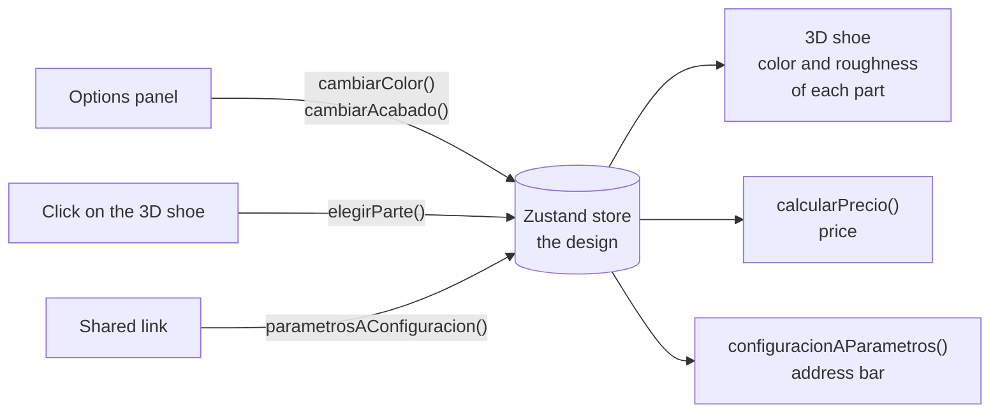

# Pisada · 3D Sneaker Configurator

A product configurator for a fictional sneaker store. Rotate the sneaker in 3D, change the color and finish of each part, see the price update and share your exact design with a link.


*The body turns red. Clicking the sole on the 3D shoe selects it in the panel. A caramel color (+US$ 10) and a glossy finish (+US$ 8) raise the price, and the address bar keeps the design. Then a full turn, and "Copiar link" copies the link.*

<!-- Live demo: add the link here after deploying -->

## Features


- **3D viewer:** drag to rotate and scroll to zoom, or swipe and pinch on a phone. Studio-like lighting with a soft shadow.
- **Five parts to customize:** body, stripes, sole, laces and details. Each one has 5 or 6 colors and a matte or glossy finish.
- **Pick a part on the shoe:** click (or tap) a part of the 3D model and the panel jumps to it.
- **Live price:** a base price of US$ 120, plus US$ 8 for each glossy part and US$ 10 for the caramel sole.
- **Share link:** the design lives in the URL (`?cuerpo=rojo&suela=caramelo`). Opening the link loads the same design, and "Copiar link" copies it.
- **Made for phones:** the sneaker stays on top while the options scroll below, and the price and the share button are always visible. Dragging on the shoe rotates it instead of scrolling the page.
- **Accessible:** every option works with the keyboard and screen readers, and the loading spinner respects "reduce motion".

The UI is in Spanish.

<br clear="right">

## Tech stack

- [Next.js](https://nextjs.org) 16 (App Router), React 19 and TypeScript
- Tailwind CSS 4
- Three.js with [React Three Fiber](https://r3f.docs.pmnd.rs) and drei
- Zustand for shared state
- glTF Transform, meshoptimizer and sharp, to prepare the 3D model
- Vitest for unit tests and Playwright for end-to-end tests
- GitHub Actions: lint, type check, tests, build and end-to-end tests on every push

## How it works



1. The panel and the 3D shoe share one Zustand store with the design: the color and finish of each part.
2. When the design changes, the 3D shoe updates its materials, the price is calculated again and the address bar gets the new link.
3. When someone opens a shared link, the design is read from the URL and loaded into the store.

## Project structure

```
configurador-3d/
├── app/                ← the page (Next.js App Router)
├── components/         ← 3D viewer, the 3D shoe, options panel, price and share button
├── hooks/              ← keeps the design and the link in sync
├── lib/                ← catalog, price and link functions (pure, unit-tested)
├── store/              ← shared state with Zustand
├── scripts/            ← splits the original 3D model into parts
├── public/modelos/     ← the prepared model (400 KB)
├── tests/              ← unit tests (Vitest), and end-to-end tests in tests/e2e (Playwright)
└── docs/               ← the GIF and the screenshot of this README
```

## Run it locally

You need Node.js 24 (see `.nvmrc`).

```bash
npm install
npm run dev
```

Then open [http://localhost:3000](http://localhost:3000).

To run the end-to-end tests, install the Playwright browser once:

```bash
npx playwright install chromium
npm run e2e
```

## Technical decisions

**The 3D model was split into parts by a script.** The original model is a single mesh, and the color of each part is painted on an image (a texture). That makes it impossible to change one part alone. [`scripts/preparar-modelo.mts`](scripts/preparar-modelo.mts) reads the texture color under each triangle, groups the triangles that touch into pieces (one lace, one stripe, the sole...) and builds one mesh per part, each with its own material. It keeps the fabric relief (normal map), removes the color textures and compresses the rest: the file goes from 7.8 MB to 400 KB, so it loads fast on a phone.

**The logic is separate from React and 3D.** The catalog (parts, colors, prices) is plain data in `lib/opciones.ts`. The price and the link are pure functions in `lib/precio.ts` and `lib/url.ts`: the same input always gives the same output, and they don't touch the page. That makes them easy to unit test.

**One store for the panel and the 3D shoe.** The options panel and the 3D shoe live in different parts of the page, but both need the design. A Zustand store holds it, so no component has to pass it down through props. Each component reads only what it needs: the 3D shoe doesn't re-render when you only switch the selected part. Changes create a new copy of the design instead of editing it in place, so React notices them.

**The link is the saved design.** There is no backend: the URL stores the design, so sharing it needs nothing else. It only stores what changed from the default design, so the link stays short. Anyone can edit a link, so every value is checked when the page reads it: an unknown color like `suela=morado` is ignored and that part keeps its default. The address bar updates with `history.replaceState`, so the back button doesn't go through every color you tried.

**Changing a color doesn't rebuild the 3D shoe.** Each part keeps its mesh and material, and React Three Fiber only updates the material's `color` and `roughness`. The finish is just roughness: 0.85 spreads the light (matte) and 0.3 reflects it (glossy).

**A click picks a part, a drag rotates.** Both start with the same mouse button. A click only selects a part if the pointer moved less than 2 pixels, and it stops there, so only the front part counts, not the ones behind it.

**The shadow is calculated once.** The shoe never moves: the camera turns around it. So the soft shadow under it is drawn once, when the model is ready, instead of on every frame. Without a graphics card, that takes the page from 9 to 14 frames per second.

**Studio lights without an image to download.** The reflections come from a few light panels built in code (drei's `Lightformer`), not from an HDR photo. There is one file less to download, and the materials still look realistic.

**The loading screen is plain HTML.** It sits on top of the 3D canvas instead of inside it, so it comes in the server's HTML and shows before JavaScript loads. The model starts downloading as soon as its code loads (`useGLTF.preload`), and the 3D shoe tells the viewer when it's ready.

**If the 3D fails, the page still works.** An error boundary wraps the viewer. If the browser can't draw 3D (no WebGL), only the viewer shows a notice: the panel, the price and the link keep working. Before, the whole page crashed.

**The phone layout keeps the shoe in view.** The page is exactly as tall as the screen (`100dvh`). The viewer takes the top 45% and only the panel scrolls. The price bar is `sticky` at the bottom. `touch-action: none` on the viewer makes a swipe rotate the shoe instead of scrolling the page, and the hint text changes with the kind of pointer (finger or mouse).

**Options are real radio buttons.** Each group of options is a set of `<input type="radio">`, hidden visually, with a custom design on top. Keyboard navigation (arrow keys) and screen reader support come for free. The price is an `<output>` with `aria-live`, so screen readers announce it when it changes.

## Tests and CI

- **Unit tests (Vitest):** 12 tests for the price and the link: surcharges, short links, reading a link back and ignoring invalid values.
- **End-to-end tests (Playwright):** 5 tests in a real browser, on a desktop screen and on a small phone (360 × 740). In CI they run against the production build. They check that picking options updates the price and the link, "Copiar link" copies it, a shared link opens the same design, invalid values are ignored, the page never scrolls as a whole, and without WebGL the panel still works.
- **CI:** GitHub Actions runs lint, type check, unit tests, build and the end-to-end tests on every push. The CI machine has no graphics card, so the browser draws the 3D with the CPU and the model takes several seconds to show up. The tests give it up to 30 seconds. If a test fails, it runs once more and saves the Playwright trace to see what happened.

## Known limitations

- The price is only calculated in the browser. A real store would calculate it again on the server before charging, with the catalog in a database.
- There is one product, and its catalog lives in the code.
- Each part has one flat color: the original color textures were removed, and only the fabric relief is kept.
- Without WebGL there is no 3D view or picture of the shoe, only a notice.

## Scripts

| Command | What it does |
|---|---|
| `npm run dev` | Starts the development server |
| `npm run build` | Builds the app for production |
| `npm start` | Runs the production build |
| `npm run lint` | Checks the code with ESLint |
| `npm run typecheck` | Checks the TypeScript types |
| `npm test` | Runs the unit tests |
| `npm run e2e` | Runs the end-to-end tests (starts the app if it isn't running) |
| `npm run modelo` | Rebuilds `public/modelos/zapatilla.glb` from the original model |

## Credits

3D model: [Materials Variants Shoe](https://github.com/KhronosGroup/glTF-Sample-Assets/tree/main/Models/MaterialsVariantsShoe) © 2021 Shopify, licensed under [CC BY 4.0](https://creativecommons.org/licenses/by/4.0/).
Changes: split into parts by color, color textures removed and compressed. See [`scripts/preparar-modelo.mts`](scripts/preparar-modelo.mts).

## License

The code is under the [MIT](LICENSE) license. The 3D model keeps its own license (CC BY 4.0, see Credits).
