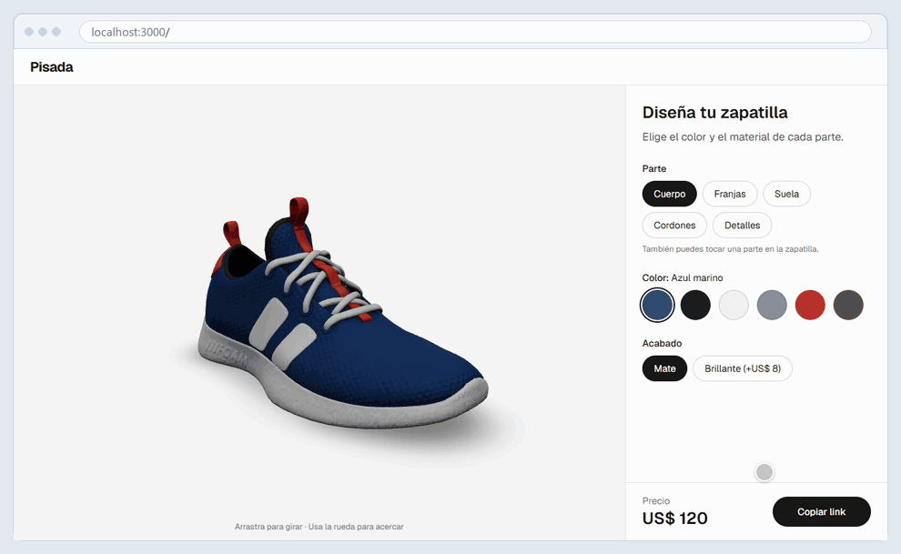
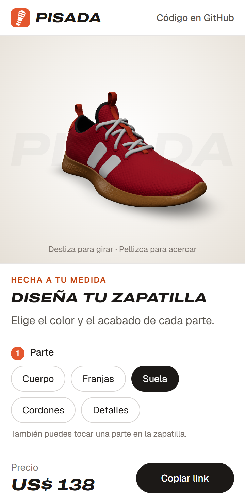
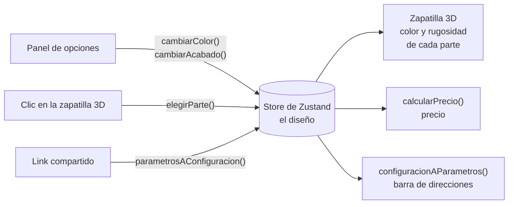

# Pisada · Configurador 3D de zapatillas

[](https://github.com/Vitomans/configurador-3d/actions/workflows/ci.yml)

Un configurador de producto para una tienda de zapatillas ficticia. Gira la zapatilla en 3D, cambia el color y el acabado de cada parte, mira cómo cambia el precio y comparte tu diseño exacto con un link.

**Demo en vivo: [pisada-3d.vercel.app](https://pisada-3d.vercel.app)**



*El cuerpo se pone rojo. Al tocar la suela en la zapatilla 3D, el panel pasa a "Suela". El color caramelo (+US$ 10) y el acabado brillante (+US$ 8) suben el precio, y la barra de direcciones guarda el diseño. Después, una vuelta completa, y "Copiar link" copia el link.*

## Funcionalidades



- **Visor 3D:** arrastra para girar y usa la rueda para acercar, o desliza y pellizca en el celular. Luces tipo estudio de fotos, un fondo de estudio y una sombra suave.
- **Entrada animada:** al cargar, la cámara se acerca con un movimiento suave y la zapatilla gira sola hasta que la tocas. Si el sistema pide reducir el movimiento, se queda quieta.
- **Cinco partes para personalizar:** cuerpo, franjas, suela, cordones y detalles. Cada una tiene 5 o 6 colores y un acabado mate o brillante.
- **Elegir una parte en la zapatilla:** al hacer clic (o tocar) una parte del modelo 3D, el panel pasa a esa parte.
- **Precio en vivo:** un precio base de US$ 120, más US$ 8 por cada parte brillante y US$ 10 por la suela caramelo.
- **Link para compartir:** el diseño se guarda en el link (`?cuerpo=rojo&suela=caramelo`). Al abrirlo se carga el mismo diseño, y "Copiar link" lo copia. Al compartirlo en WhatsApp o LinkedIn se ve una imagen de la tienda.
- **Pensado para el celular:** la zapatilla queda fija arriba mientras las opciones se desplazan abajo, y el precio y el botón para compartir siempre se ven. Arrastrar sobre la zapatilla la gira en vez de mover la página.
- **Accesible:** todas las opciones funcionan con el teclado y con lectores de pantalla, y el círculo de carga respeta la opción "reducir movimiento".

<br clear="right">

## Tecnologías

- [Next.js](https://nextjs.org) 16 (App Router), React 19 y TypeScript
- Tailwind CSS 4
- Three.js con [React Three Fiber](https://r3f.docs.pmnd.rs) y drei
- Zustand para el estado compartido
- `next/og` para dibujar la imagen para compartir el link
- glTF Transform, meshoptimizer y sharp, para preparar el modelo 3D
- Vitest para los tests unitarios y Playwright para los tests de punta a punta (e2e)
- GitHub Actions: lint, tipos, tests, build y tests e2e en cada push

## Cómo funciona



1. El panel y la zapatilla 3D comparten un store de Zustand con el diseño: el color y el acabado de cada parte.
2. Cuando cambia el diseño, la zapatilla 3D actualiza sus materiales, el precio se vuelve a calcular y la barra de direcciones recibe el link nuevo.
3. Cuando alguien abre un link compartido, el diseño se lee del link y se carga en el store.

## Estructura del proyecto

```
configurador-3d/
├── app/                ← la página (App Router de Next.js), el ícono y la imagen para compartir
├── assets/             ← la letra y la foto de la zapatilla que usa la imagen para compartir
├── components/         ← visor 3D, cámara, la zapatilla 3D, logo, panel de opciones, precio y botón para compartir
├── hooks/              ← mantiene sincronizados el diseño y el link
├── lib/                ← catálogo y funciones del precio y del link (puras, con tests)
├── store/              ← estado compartido con Zustand
├── scripts/            ← separa en partes el modelo 3D original
├── public/modelos/     ← el modelo ya preparado (400 KB)
├── tests/              ← tests unitarios (Vitest), y tests e2e en tests/e2e (Playwright)
└── docs/               ← el GIF y la captura de este README
```

## Cómo correrlo en local

Necesitas Node.js 24 (ver `.nvmrc`).

```bash
npm install
npm run dev
```

Después abre [http://localhost:3000](http://localhost:3000).

Para correr los tests e2e, instala una vez el navegador de Playwright:

```bash
npx playwright install chromium
npm run e2e
```

## Decisiones técnicas

**Un script separó el modelo 3D en partes.** El modelo original es una sola malla, y el color de cada parte está pintado en una imagen (una textura). Así no se puede cambiar una parte sola. [`scripts/preparar-modelo.mts`](scripts/preparar-modelo.mts) lee el color de la textura bajo cada triángulo, junta en piezas los triángulos que se tocan (un cordón, una franja, la suela...) y arma una malla por parte, cada una con su propio material. Mantiene el relieve de la tela (normal map), quita las texturas de color y comprime el resto: el archivo baja de 7,8 MB a 400 KB, así que carga rápido en el celular.

**La lógica está separada de React y del 3D.** El catálogo (partes, colores y precios) son solo datos, en `lib/opciones.ts`. El precio y el link son funciones puras en `lib/precio.ts` y `lib/url.ts`: con lo mismo siempre devuelven lo mismo, y no tocan la página. Por eso es fácil hacerles tests unitarios.

**Un solo store para el panel y la zapatilla 3D.** El panel de opciones y la zapatilla 3D están en partes distintas de la página, pero los dos necesitan el diseño. Lo guarda un store de Zustand, así ningún componente tiene que pasarlo hacia abajo por props. Cada componente lee solo lo que necesita: la zapatilla 3D no se vuelve a dibujar cuando solo cambias la parte elegida. Los cambios crean una copia nueva del diseño en vez de modificarlo, así React se da cuenta de que algo cambió.

**El link es el diseño guardado.** No hay backend: el link guarda el diseño, así que para compartirlo no se necesita nada más. Solo guarda lo que cambió respecto al diseño inicial, así el link queda corto. Cualquiera puede escribir un link, así que la página revisa cada valor al leerlo: un color que no existe, como `suela=morado`, se ignora y esa parte queda como al inicio. La barra de direcciones se actualiza con `history.replaceState`, así el botón "atrás" no pasa por cada color que probaste.

**Cambiar un color no vuelve a armar la zapatilla 3D.** Cada parte mantiene su malla y su material, y React Three Fiber solo actualiza el `color` y la rugosidad (`roughness`) del material. El acabado es solo la rugosidad: 0,85 reparte la luz (mate) y 0,3 la refleja (brillante).

**Un clic elige una parte y arrastrar gira.** Las dos cosas empiezan con el mismo botón del mouse. Un clic solo elige una parte si el puntero se movió menos de 2 píxeles, y se detiene ahí, así solo cuenta la parte de más adelante y no las que están detrás.

**La cámara entra sola y la zapatilla gira hasta que la tocas.** En vez de `OrbitControls` se usa `CameraControls` de drei, que además de girar y acercar sabe llevar la cámara a un punto con un movimiento suave: `setLookAt(..., true)` hace el viaje y devuelve una promesa que se cumple cuando la cámara llega. Ahí empieza el giro: en cada cuadro (`useFrame`) se le suma un poco al ángulo de la cámara, multiplicado por `delta` (los segundos desde el cuadro anterior), así gira a la misma velocidad en un computador rápido o lento. Si está girando o no se guarda en un `useRef` y no en un `useState`, porque cambiarlo no necesita volver a dibujar nada en React. Apenas la persona toca la zapatilla o usa la rueda (`onStart`), deja de girar. Si el sistema pide reducir el movimiento (`prefers-reduced-motion`), la cámara salta a su lugar y no gira.

**El fondo de estudio es HTML, detrás de un canvas transparente.** El canvas 3D no tiene fondo propio. El degradado claro al centro y el nombre "PISADA" gigante son HTML normal que está detrás, así que no le suman trabajo al 3D. El tamaño del nombre se mide con el ancho del visor (`cqw`, con `@container` de Tailwind), así cabe igual en el celular y en el escritorio.

**La imagen para compartir se dibuja al compilar.** [`app/opengraph-image.tsx`](app/opengraph-image.tsx) arma la imagen con JSX y `ImageResponse` de `next/og`, y Next.js agrega solo las etiquetas `og:image` que leen WhatsApp, LinkedIn y otros. El 3D no se puede dibujar en el servidor, así que la imagen usa una foto de la zapatilla con fondo transparente, sacada de la misma página. La letra de la marca (Archivo) es "variable" en la página: un solo archivo trae todos los anchos y grosores. `next/og` no entiende ese tipo de archivo, así que usa uno fijo con la versión extendida, gruesa y en cursiva.

**La sombra se calcula una sola vez.** La zapatilla nunca se mueve: lo que gira es la cámara. Por eso la sombra suave de abajo se dibuja una vez, cuando el modelo está listo, y no en cada cuadro. Sin tarjeta de video, eso sube la página de 9 a 14 cuadros por segundo.

**Luces de estudio sin descargar una imagen.** Los reflejos vienen de unos paneles de luz armados en el código (`Lightformer` de drei), no de una foto HDR. Hay un archivo menos que descargar y los materiales igual se ven realistas.

**La pantalla de carga es HTML normal.** Va encima del canvas 3D y no adentro, así viene en el HTML del servidor y se ve antes de que cargue JavaScript. El modelo empieza a descargarse apenas carga su código (`useGLTF.preload`), y la zapatilla 3D le avisa al visor cuando está lista.

**Si el 3D falla, la página sigue funcionando.** Un límite de error (error boundary) envuelve el visor. Si el navegador no puede dibujar 3D (no tiene WebGL), solo el visor muestra un aviso: el panel, el precio y el link siguen funcionando. Antes se caía toda la página.

**En el celular, la zapatilla siempre se ve.** La página mide justo el alto de la pantalla (`100dvh`). El visor ocupa el 45 % de arriba y solo el panel se desplaza. La barra del precio queda pegada abajo (`sticky`). Con `touch-action: none` en el visor, deslizar el dedo gira la zapatilla en vez de mover la página, y el texto de ayuda cambia según el tipo de puntero (dedo o mouse).

**Las opciones son botones de radio de verdad.** Cada grupo de opciones es un conjunto de `<input type="radio">` escondidos a la vista, con un diseño propio encima. Así funcionan con el teclado (flechas) y con lectores de pantalla sin programar nada extra. El precio es un `<output>` con `aria-live`, así los lectores de pantalla lo anuncian cuando cambia.

## Tests y CI

- **Tests unitarios (Vitest):** 12 tests del precio y del link: recargos, links cortos, volver a leer un link y descartar valores que no existen.
- **Tests e2e (Playwright):** 8 tests en un navegador de verdad, en una pantalla de escritorio y en un celular chico (360 × 740). En el CI corren contra la versión compilada. Revisan que elegir opciones actualice el precio y el link, que "Copiar link" lo copie, que un link compartido abra el mismo diseño, que se ignoren los valores que no existen, que la página nunca se desplace entera, que sin WebGL el panel siga funcionando, que la zapatilla gire sola hasta tocarla y se quede quieta si el sistema pide reducir el movimiento, y que existan el ícono y la imagen para compartir. Para saber si la zapatilla está quieta, el test saca dos fotos del visor con medio segundo de diferencia: si son idénticas, no se movió.
- **CI:** GitHub Actions corre lint, tipos, tests unitarios, build y tests e2e en cada push. La máquina del CI no tiene tarjeta de video, así que el navegador dibuja el 3D con el procesador (unos 12 cuadros por segundo) y el modelo tarda varios segundos en aparecer. Los tests le dan hasta 30 segundos y corren de a 2 (en local, de a uno). Si un test falla, se corre otra vez y se guarda la traza de Playwright para ver qué pasó.

## Limitaciones conocidas

- El precio solo se calcula en el navegador. Una tienda real lo volvería a calcular en el servidor antes de cobrar, con el catálogo en una base de datos.
- Hay un solo producto, y su catálogo está en el código.
- Cada parte tiene un solo color plano: se quitaron las texturas de color originales y solo queda el relieve de la tela.
- Sin WebGL no hay vista 3D ni foto de la zapatilla, solo un aviso.
- La imagen para compartir muestra siempre la zapatilla con sus colores iniciales, no el diseño del link.

## Comandos

| Comando | Qué hace |
|---|---|
| `npm run dev` | Levanta el servidor de desarrollo |
| `npm run build` | Compila la página para producción |
| `npm start` | Corre la versión compilada |
| `npm run lint` | Revisa el código con ESLint |
| `npm run typecheck` | Revisa los tipos de TypeScript |
| `npm test` | Corre los tests unitarios |
| `npm run e2e` | Corre los tests e2e (levanta la página si no está corriendo) |
| `npm run modelo` | Vuelve a generar `public/modelos/zapatilla.glb` desde el modelo original |

## Créditos

Modelo 3D: [Materials Variants Shoe](https://github.com/KhronosGroup/glTF-Sample-Assets/tree/main/Models/MaterialsVariantsShoe) © 2021 Shopify, con licencia [CC BY 4.0](https://creativecommons.org/licenses/by/4.0/).
Cambios: separado en partes según el color, sin las texturas de color y comprimido. Ver [`scripts/preparar-modelo.mts`](scripts/preparar-modelo.mts).

Letra de la marca: [Archivo](https://github.com/Omnibus-Type/Archivo) © 2020 The Archivo Project Authors, con licencia [SIL Open Font License 1.1](assets/OFL.txt).

## Licencia

El código tiene licencia [MIT](LICENSE). El modelo 3D y la letra mantienen sus propias licencias (CC BY 4.0 y OFL 1.1, ver Créditos).
